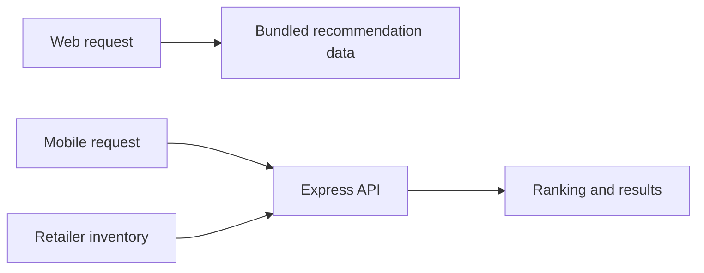

# Technical case study: Myra

## Problem
Users need understandable beverage recommendations, while retailer placement must obey explicit commercial ranking rules.

## Approach
The static web client uses bundled recommendation data and parsing modules. An Expo mobile client connects to an Express API. Retailer features use PostgreSQL, inventory CSV uploads and subscription integration.



## Evaluation
[Ranking tests](backend/src/tests/rankingService.test.ts) use synthetic retailers to check premium-first placement and distance ordering. This is a testable commercial rule, not proof of recommendation relevance.

```sh
cd backend
npm ci
npm run lint
npm run build
npm test
```

## Demonstration
[Web demo](https://robbiecalvin.github.io/myra/) and [desktop screenshot](assets/images/desktopfrontpagescreenshot.png). See [README](README.md) for mobile and API setup.

## Limitations
No measured recommendation accuracy, conversion uplift or verified live retailer coverage is claimed. Payment integration requires separately configured test credentials.

## Resume summary
Developed a cross-platform recommendation application and synthetic-fixture tests for deterministic retailer ranking.

## Verified CI evidence — 2026-11-25

Backend lint, build and one automated test passed. This is not a measured recommendation accuracy result.

- [GitHub Actions run](https://github.com/robbiecalvin/myra/actions/runs/45641441984)
- [Tested revision](https://github.com/robbiecalvin/myra/commit/126f78ac00666cd93d4196beeafd3407d475a123)

Results were inspected from completed job logs. They apply to the linked revision and executed checks only.
