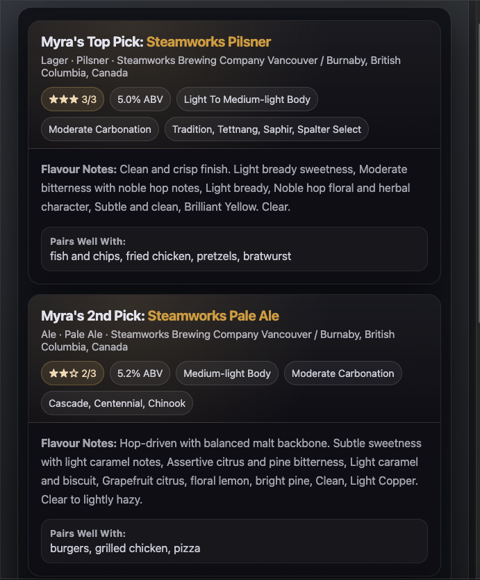
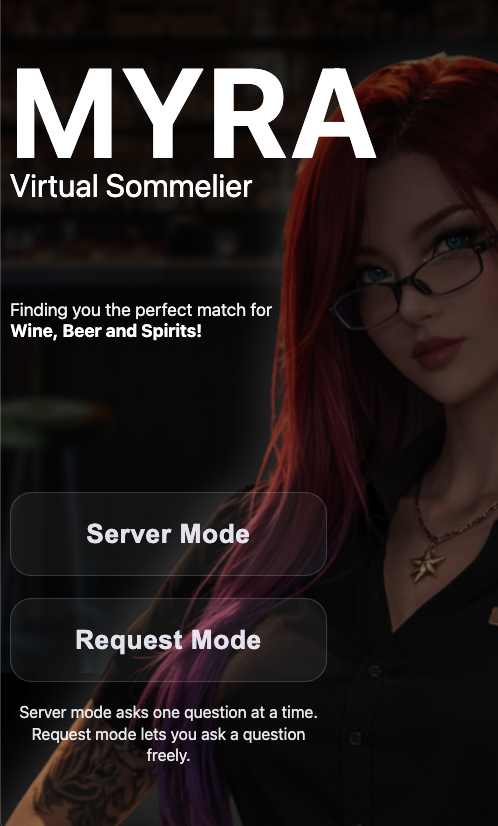
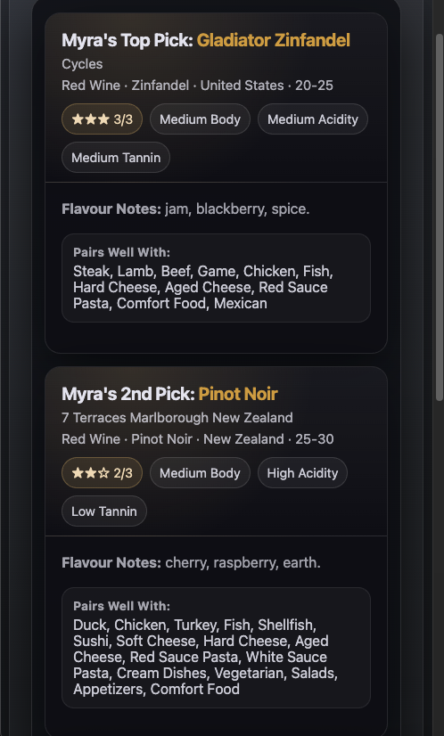

# Myra - Virtual Sommelier

Myra helps you choose wine and beer through a guided flow or a free-form request. The web app runs with bundled recommendation data. The Expo app for Android and iOS gets recommendations from the Express API.

## Version

Current version: `v0.3`

## What’s New

- The web app has responsive guided and request flows, top-three recommendation cards, and retailer links.
- The retailer API supports account registration, store profiles, Stripe subscriptions, premium inventory CSV uploads, and premium-first ranking for nearby stores.
- Since the v0.3 release, the web app has gained a simpler results layout and a home-screen install option.

## Install the Web App

Open Myra and select **Install Myra** for your browser’s prompt or instructions. In Safari on iPhone or iPad, use **Share → Add to Home Screen**. In Chrome on Android, use **⋮ → Add to Home screen** and choose **Install** if offered.

[Open Myra](https://robbiecalvin.github.io/myra/)

## Screenshots

### Desktop


### Tablet




### Mobile




## Project Layout

- `/index.html` - web app entry point
- `/css` - styling for web experience
- `/js` - client-side voice + parsing modules
- `/data` - recommendation data and mappings
- `/backend` - Express API and services
- `/mobile` - Expo app for Android and iOS

## Local Development

### Web

Run a static server from the repository root and open `http://localhost:8000`.

```bash
python3 -m http.server 8000
```

### Backend

```bash
cd backend
npm ci
npm run dev
```

The API defaults to `http://localhost:4000`. Check startup at `/health`.

For retailer features, create a PostgreSQL database and export `DATABASE_URL` and `JWT_SECRET` in the shell before starting the API. Run `npm run migrate` from `backend/` with `DATABASE_URL` set. For Stripe checkout and webhook testing, also export `STRIPE_SECRET_KEY`, `STRIPE_WEBHOOK_SECRET`, and `STRIPE_PRICE_ID`. See the [environment variable template](.env.example).

### Mobile (Android + iOS)

```bash
cd mobile
npm ci
cp .env.example .env
```

Set `EXPO_PUBLIC_API_BASE_URL` in `mobile/.env` to an API URL reachable from your device or emulator. For a physical device, use your development machine’s LAN address or a deployed API. Then run `npm start` from `mobile/`.

Production builds and store submission:

```bash
cd mobile
npx eas-cli login
npx eas-cli init
npm run build:android
npm run build:ios
npm run submit:android
npm run submit:ios
```

Release configuration files
- `mobile/app.config.ts`
- `mobile/eas.json`
- `mobile/.env.example`

## Verification Commands

```bash
(cd backend && npm run lint && npm run build && npm test)
(cd mobile && npm run lint && npm run build)
```

## Update Report

[Myra v0.3 Update Report](myra-v0.3-updates.md)
